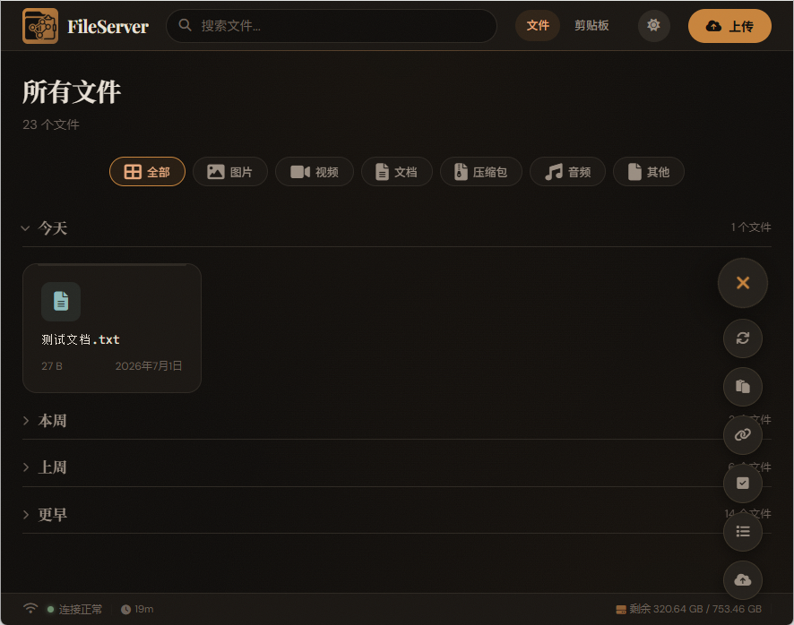

<p align="center">
	
</p>


<h1 align="center">FileServer</h1>

<p align="center">FileServer 是一个浏览器即可使用的<strong>局域网</strong>跨设备文件传输 + 轻量剪贴板同步工具。<br>
它无需联网，一次部署，永久使用。手机扫码即连，支持公网域名，内外兼容。</p>

## 主要功能

+ 文件上传（内网直传 / 外网分片自适应）、批量压缩打包并下载、删除、重命名
+ 在线预览：图片、PDF、音视频、压缩包（ZIP / 7z / Tar）、文本/代码（高亮编辑器，支持在线编辑保存）
+ 跨设备剪贴板同步（文字 + 链接识别）
+ 提供二维码入口，手机扫码即用
+ 生成文件分享和临时上传入口链接
+ 深 / 浅色主题切换
+ 智能下载：内网直接下载，外网分块 + Blob 拼接下载
+ 文件类型筛选、网格/列表双视图切换
+ 移动端拍照 / 相册直传
+ 查看完整功能清单：[详细功能](#详细功能)

## 快速开始

无需安装任何环境，下载即用，或自行构建。

### 桌面端

1. 将 **下载的可执行文件** 放到任意目录（如 `D:\FileServer\`）运行
2. 首次启动自动生成数据文件：`shared-files\`（共享文件）、`config.json`（配置）、`temp-*`（缓存）
3. 启动后自动打开浏览器，终端同时打印二维码
4. 迁移 = 复制整个文件夹

### 移动端

+ 安装 APK 后直接启动即可

> **ffmpeg（可选）**：如需视频缩略图，安装 ffmpeg 并加入 PATH，或设置环境变量 `FFMPEG_PATH` 指向 ffmpeg.exe；未安装时其余功能不受影响。
>
> **杀软提示**：单文件可执行程序可能被杀毒软件误报，可添加信任或自行从源码构建。

## 终端启动

Windows 用户使用 **CMD** 或 **PowerShell**，Mac 用户使用 **Terminal**。

### 环境检测

```powershell
# 检查 Go 版本（1.27+，仅源码构建需要）
go version
# 检查 Nodejs 版本
node -v
# FFmpeg 用于视频缩略图预览（非必需）
ffmpeg -version
```

如果未安装，请访问：

+ [Go 下载](https://go.dev/dl/)
+ [Nodejs 下载](https://nodejs.org/)
+ [FFmpeg 下载](https://ffmpeg.org/download.html)

### 获取代码

```powershell
# 使用 git 获取代码
git clone https://github.com/Roipyon/FileServer.git
cd FileServer
```

或者直接前往 [Releases](https://github.com/Roipyon/FileServer/releases/tag/v2.0.0) 下载。

### 启动服务

**Windows**：

```powershell
# 1. 前端产物
npm install
npm run build        # 产物输出到 dist/

# 2. 同步前端产物到嵌入目录（首次或前端更新后）
Copy-Item -Path dist -Destination backend\dist -Recurse -Force

# 3. 构建（需 Go 1.27+）
cd backend
go build -ldflags "-s -w -X main.appVersion=2.0.0" -o FileServer-win.exe .
```

或使用构建脚本：

```powershell
# 自动同步前端产物 + 编译，产出单文件 FileServer-win.exe
powershell -NoProfile -ExecutionPolicy Bypass -File backend\build.ps1
```

**macOS / Linux**：

```bash
# 1. 安装前端依赖并构建产物
npm install
npm run build

# 2. 同步前端产物到嵌入目录
cp -r dist backend/

# 3. 交叉编译（按目标平台三选一）
cd backend
CGO_ENABLED=0 GOOS=darwin GOARCH=arm64 go build -o FileServer-mac .   # Apple Silicon
CGO_ENABLED=0 GOOS=darwin GOARCH=amd64 go build -o FileServer-mac .   # Intel Mac
CGO_ENABLED=0 GOOS=linux  GOARCH=amd64 go build -o FileServer-linux .
```

**Android（APK）**：

```bash
# 1. 交叉编译 Go 二进制进 jniLibs（arm64 供真机、x86_64 供模拟器；x86_64 用 GOOS=linux 静态链接；嵌入依赖 backend/dist/，缺失时先按桌面端第 2 步复制）
cd backend
CGO_ENABLED=0 GOOS=android GOARCH=arm64 go build -trimpath -ldflags "-s -w" -o ../android/app/src/main/jniLibs/arm64-v8a/libfileserver.so .
CGO_ENABLED=0 GOOS=linux  GOARCH=amd64 go build -trimpath -ldflags "-s -w" -o ../android/app/src/main/jniLibs/x86_64/libfileserver.so .

# 2. 组装 APK（需 Android SDK + JDK 17+）
cd ../android
./gradlew assembleDebug     # 调试包
./gradlew assembleRelease   # 发布包（debug 密钥签名，可直接侧载）
# 产物：app/build/outputs/apk/<variant>/app-<variant>.apk
```

## 配置（可选）

根目录处 config.json 参数解析：

| 配置项            | 说明                                        | 默认值                |
| :---------------- | :------------------------------------------ | :-------------------- |
| `port`            | 服务端口（被占用时自动 +1 重试）            | `3000`                |
| `root`            | 文件存储根目录                              | `./shared-files`      |
| `cacheTTL`        | 文件列表缓存时间（秒）                      | `5`                   |
| `publicUrl`       | 公网访问地址（配置后可在连接面板切换）      | `""`（空）            |
| `logAccess`       | 是否在终端输出访问日志                      | `false`               |
| `rateLimit`       | 每分钟最大请求数（按 IP 统计，实际按类型分桶） | `5000` |
| `rateLimitWindow` | 限流时间窗口（毫秒）                        | `60000`               |
| `maxUploadSize`   | 单文件上传大小上限（字节）                  | `10737418240`（10GB） |

> **优先级**：`config.json` < 环境变量（环境变量会覆盖配置文件中的同名配置）
>
> 例如：`PORT=3001` 启动会覆盖 `config.json` 中的 `port: 3000`
>
> 全部环境变量：`PORT`、`STORAGE_PATH`（共享目录）、`FILESERVER_HOME`（数据根目录）、`PUBLIC_URL`、`CACHE_TTL`、`LOG_ACCESS`（访问日志）、`FFMPEG_PATH`、`NO_OPEN=1`（不自动打开浏览器）、`FS_DEBUG_HEADERS`（请求调试日志）

## 开发者模式

如果从源码构建，遵循以下步骤：

```powershell
# 1. 克隆项目到本地
git clone https://github.com/Roipyon/FileServer.git
cd FileServer

# 2. 安装前端依赖
npm install

# 3. 构建前端产物（Go 构建时自动内嵌）
npm run build

# 4. 运行后端（开发模式）
cd backend
go run .

# 5. 运行前端（开发模式）
npm run dev:vite
```

## 详细功能

| 功能模块       | 说明                                                         |
| -------------- | ------------------------------------------------------------ |
| **文件管理**   | 上传（内网直传 / 外网 1MB 分片自适应）、下载（内网直链 / 外网 Blob 拼接）、删除、重命名、搜索、排序、类型筛选（图片/视频/文档/压缩包/音频/其他）、网格/列表双视图切换、批量打包下载（含进度条及浏览器通知）；上传前重名检测确认；上传后自动定位高亮；批量选择删除；滑动批量选择 |
| **文件预览**   | 图片（缩放、平移、旋转、翻页导航）、PDF（canvas 渲染）、音视频（HTTP Range 拖拽进度）、文本/代码（CodeMirror 6 多语言语法高亮，支持编辑 Ctrl+S 保存）、Markdown（marked 渲染）、压缩包内部目录树（ZIP / 7z / Tar，2GB+ 大文件秒开）；视频自动截取封面（需 ffmpeg）；音频封面提取；加密压缩包检测提示；Office 格式暂不支持 |
| **连接与访问** | 终端二维码扫码即用；连接面板一键切换内网/公网地址；自定义临时地址（ngrok/frp 等隧道）自动生成对应二维码；支持 IPv4 与 IPv6 双栈 |
| **剪贴板同步** | 跨设备文字同步；自动识别链接并提供一键打开；按时间分组展示（今天/昨天/本周/更早）；设备名颜色标识；批量删除与清空；快速粘贴（从系统剪贴板读取直接发送） |
| **分享与协作** | 文件分享链接（一次性 / 持续有效）；单向上传链接（只能上传，无法查看文件列表），无需对方登录，服务重启后失效 |
| **运维与可靠** | 磁盘剩余空间显示（上传前检查，不足 500MB 拒绝）；状态栏服务运行时长；启动自动打开浏览器；端口被占用时自动降级；访问日志记录（可选）；Docker 环境自动检测；临时文件自动清理 |
| **性能与体验** | 内存缓存文件列表（TTL 5s，变更自动失效）；上传速度与剩余时间显示；批量选择删除；图片预览旋转；支持 ETag / 304 缓存优化；深 / 浅色主题；响应式设计；移动端拍照 / 相册直传 |
| **安全性**     | 请求频率限制（按上传/下载/列表/缩略图/分享类型分桶限流，非单一阈值）；文件名路径遍历防护；文件占用锁检测；上传文件大小可配置（默认 10GB）；分享链接无需登录，但纯内存存储随服务关闭失效；`config.json` 与环境变量双重配置 |
